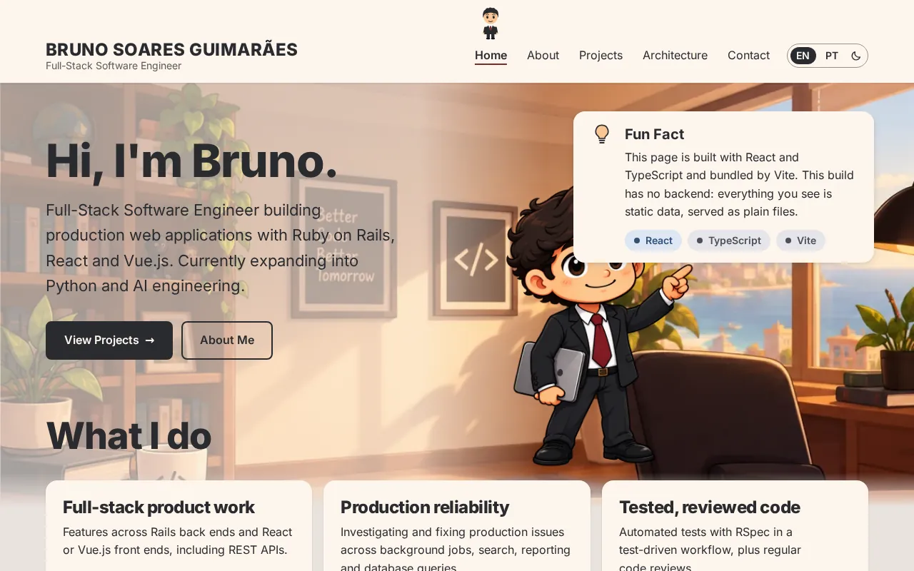
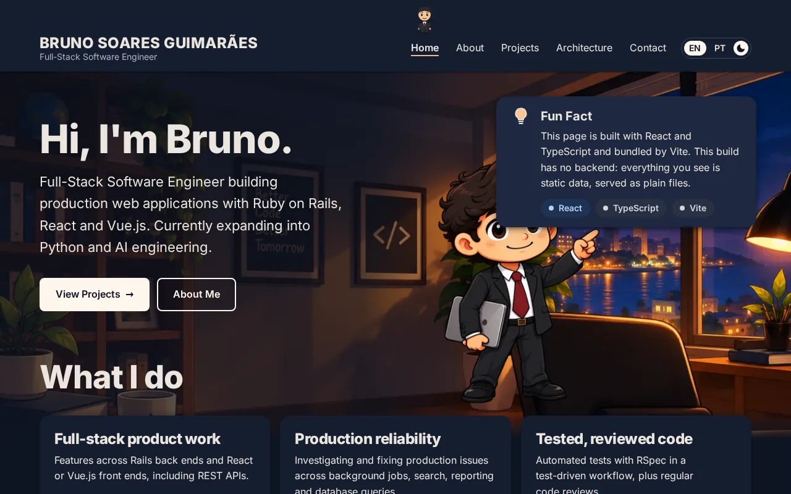

# Developer Portfolio

[](https://github.com/BrunoSGuima/developer-portfolio/actions/workflows/ci.yml)

The interactive portfolio of **Bruno Soares Guimarães**, Full-Stack Software Engineer (Ruby on
Rails, React, TypeScript). It's both a showcase and an engineering project: a React and
TypeScript site built as a persistent shell, a tested Ruby on Rails API with PostgreSQL behind it,
and a **Fun Fact** on every page that tells you which technology is really running there.

> **Live:** [bruno-guimaraes.pages.dev](https://bruno-guimaraes.pages.dev/), the static build on
> Cloudflare Pages ([ADR-0016](./docs/adr/0016-static-first-deployment.md)). The Rails API and
> PostgreSQL run locally and aren't deployed. Still evolving; see the
> [roadmap](./docs/ROADMAP.md).

| Light                                                         | Dark                                                        |
| ------------------------------------------------------------- | ----------------------------------------------------------- |
|  |  |

## What you'll find

- **Five pages:** Home, About, Projects, Architecture and Contact.
- **English and Brazilian Portuguese**, each with its own URLs (`/pt-br`); the language switcher
  keeps you on the same page.
- **Light and dark themes**, following your system until you choose one
  ([ADR-0017](./docs/adr/0017-light-and-dark-themes.md)). The Home illustration has a day and a
  night version.
- **A Fun Fact on every page** describing the real stack behind it, and an **Architecture** page
  that separates what's built from what's planned.
- **An illustrated Home and a mascot** that walks along the navigation (purely decorative; it
  doesn't animate when you prefer reduced motion).
- **Accessibility built in:** semantic landmarks, keyboard navigation, visible focus, reduced
  motion and high-contrast support, aiming at WCAG 2.2 AA (automated axe checks in CI).

## How it's built

**Implemented, and part of the public site**

- **A React shell** (React 19, TypeScript, Vite, React Router): one app that owns the layout,
  navigation, routing, page transitions, the Fun Fact and the mascot, and stays mounted while
  pages change.
- **A section registry:** one list that defines every page, its route, its Fun Fact and its
  technologies.
- **A microfrontend host:** the shell can mount independently built apps through a small
  `mount()` / `unmount()` contract. It's tested with a stand-in app; **no real remote section
  exists yet**.

**Implemented, running locally (not deployed)**

- **A Ruby on Rails 8.1 API** with **PostgreSQL 18**: the projects (bilingual data as JSONB) and
  a contact form (validation, rate limiting, a honeypot, minimal personal data). The API is
  described by an **OpenAPI** contract that both the API's tests and the shell's typed client
  follow.
- **Two build modes from one codebase:** the **static** site uses local data and needs no server.
  The **full-stack** site reads the projects from the API and adds the contact form. The public
  site is the static one, so the portfolio has no recurring server cost; the full stack
  runs locally ([ADR-0016](./docs/adr/0016-static-first-deployment.md)).
- **A production Docker image** in which Rails serves the site and the API from one origin, with
  security headers and an enforced Content Security Policy. It's built and smoke-tested in CI.

**Planned**

- A Vue.js section mounted by the React shell, a Python (FastAPI) service, background jobs, and
  AI engineering experiments. The order is provisional; see the [roadmap](./docs/ROADMAP.md).

## Tech stack

| Area            | Technologies                                                                   |
| --------------- | ------------------------------------------------------------------------------ |
| Frontend        | React 19, TypeScript, Vite, React Router, CSS Modules with design tokens       |
| Backend (local) | Ruby 4.0, Ruby on Rails 8.1 (API-only), PostgreSQL 18, OpenAPI 3.0             |
| Testing         | Vitest, React Testing Library, Playwright with axe-core, RSpec, FactoryBot     |
| Quality and CI  | ESLint, Prettier, RuboCop, Brakeman, bundler-audit, GitHub Actions             |
| Hosting         | Cloudflare Pages (static site); the full stack runs locally via Docker Compose |

## Quality

Every push and pull request runs five CI jobs:

- formatting, lint, types and unit tests
- the end-to-end suite with automated accessibility checks, in both languages and both themes,
  against the static and the full-stack builds
- the Rails API's checks: RuboCop, security audits, and RSpec with OpenAPI contract validation
  against PostgreSQL
- a build and smoke test of the production image

Architecture decisions are recorded as [ADRs](./docs/adr/).

## Roadmap

| Phase | Scope                                                                                | Status  |
| ----- | ------------------------------------------------------------------------------------ | ------- |
| 1     | React frontend foundation: shell, static data, mascot, Fun Fact, en/pt-BR, tests, CI | Done    |
| 2     | Ruby on Rails API + PostgreSQL: projects, contact messages, RSpec, OpenAPI           | Done    |
| 3     | Frontend/backend integration, full-stack validation and MVP completion               | Done    |
| 4     | Public release of the static site on Cloudflare Pages; the full stack stays local    | Done    |
| 5     | Vue 3 microfrontend mounted by the React shell                                       | Planned |
| 6     | Python FastAPI service + interactive quiz                                            | Planned |
| 7     | Background jobs (Redis + Sidekiq)                                                    | Planned |
| 8     | AI Lab and future expansion                                                          | Planned |

Details, decisions and evidence for every step: [`docs/ROADMAP.md`](./docs/ROADMAP.md).

## Run it locally

```bash
nvm use        # Node.js 22 (see .nvmrc)
npm install
npm run dev    # http://localhost:5173 (the static site)
```

The full-stack mode, tests, builds and the production image are covered in the
[development guide](./docs/DEVELOPMENT.md).

## Documentation

- [Development guide](./docs/DEVELOPMENT.md): setup, commands, build modes, tests and CI.
- [Roadmap](./docs/ROADMAP.md): phases, steps, decisions and evidence.
- [Architecture Decision Records](./docs/adr/).
- [Rails API](./services/api/README.md): its setup, endpoints and checks.
- [Cloudflare Pages](./deploy/cloudflare-pages/README.md): the static hosting setup.
- [`CLAUDE.md`](./CLAUDE.md): architecture, conventions and the development workflow, for
  maintainers.

## Author

Bruno Soares Guimarães, [LinkedIn](https://www.linkedin.com/in/bruno-sguimaraes) ·
[GitHub](https://github.com/BrunoSGuima).

## License

All rights reserved; source available for review. The repository is public for portfolio and
code-review purposes; no license to reuse it is granted.
